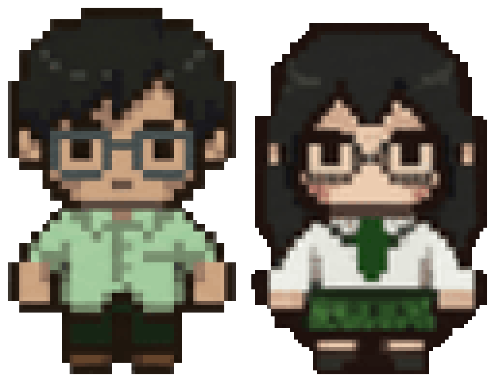
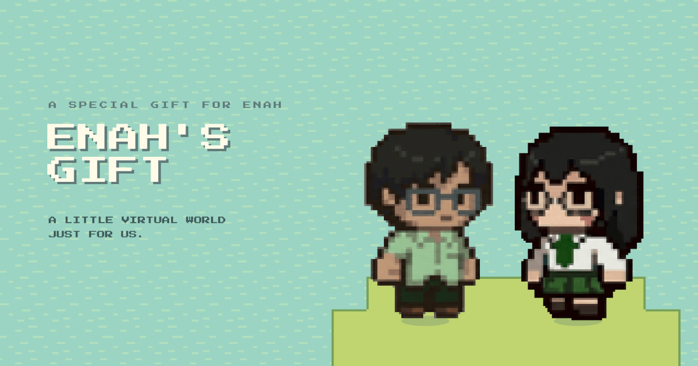

<p align="center">
  
</p>

<h1 align="center">Enah's Gift</h1>

<p align="center">
  <em>A little virtual world, just for two.</em>
</p>

<p align="center">
  
  
  
  
  
</p>

<p align="center">
  
</p>

---

## About

**Enah's Gift** is a private, pixel-art web game built as an anniversary gift for one person. Two characters share a small island: they can walk around together in realtime, read a letter, write in a shared journal and keep a photo album full of polaroids and stickers.

It was made for an audience of one and isn't meant for public use. The code is shared here for reference and as a portfolio piece.

## Features

- **Secret-code login.** Two passcodes, one for each character. Whichever code is entered decides whether you play the boy or the girl.
- **A hand-built island.** A 16×16-tile map made in [Tiled](https://www.mapeditor.org/), with trees, water, a plateau and three things to find.
- **Realtime together.** Both players appear on the same island and see each other move live, with smooth interpolation.
- **The letter.** Walk up to the paper near the spawn point and press <kbd>E</kbd> to read it.
- **The journal.** A two-page diary spread. Both people can write in it, edits autosave, and changes show up live on the other screen.
- **The album.** Polaroids with captions and "puffy" emoji stickers you can drop on the page and drag around. Photos are compressed in the browser before upload, and everything syncs live.
- **Phone ready.** On-screen D-pad and a USE button appear automatically on touch devices.
- **Soundtrack.** Looping background music with a mute button.

## Controls

| Action | Desktop | Mobile |
| --- | --- | --- |
| Move | <kbd>W</kbd> <kbd>A</kbd> <kbd>S</kbd> <kbd>D</kbd> or arrow keys | On-screen D-pad |
| Interact (letter, diary, album) | <kbd>E</kbd> | **USE** button |
| Mute / unmute | Speaker button (top right) | Speaker button |

Mobile controls show up automatically on touch devices. To force them on or off, add `?mobileControls=1` or `?mobileControls=0` to the URL.

## How it works

The app is a **React** shell wrapped around a **Phaser** game. They talk through a small event bus (`src/game/EventBus.ts`):

```
┌──────────────── React (src/App.tsx) ────────────────┐
│  Login ─▶ role (boy | girl)                          │
│  LetterUI · DiaryUI · GalleryUI   (modal overlays)   │
│  Mobile D-pad / USE / mute buttons                   │
└───────────────▲──────────────────────┬───────────────┘
                │ EventBus             │ EventBus
                │ open-paper / diary / │ set-user-role,
                │ gallery              │ interaction-start/end,
                │                      │ mobile-direction-change
┌───────────────┴──────────────────────▼───────────────┐
│  Phaser scene (src/game/scenes/Game.ts)              │
│  Tiled map · player + other player · interactables   │
└──────────────────────────┬───────────────────────────┘
                           │
                  Supabase (supabase-js)
```

**Multiplayer.** Movement uses Supabase Realtime **broadcast** on the `public:island_room` channel with `join`, `move` and `leave` events. Position, animation and frame are sent about every 80 ms, and the other character is drawn as a second sprite.

**Journal and album.** Both use Postgres tables with `postgres_changes` subscriptions, so edits appear on the other person's screen as they happen. The diary autosaves shortly after you stop typing and again when you close it. Page 1 is a fixed welcome page. Album photos live in a Supabase Storage bucket.

**World.** The map is `public/assets/map/gallery-map.tmx` (exported to `.json` for Phaser). Its `Interactables` object layer defines the letter, the diary and the album. Walking into one and pressing <kbd>E</kbd> opens the matching overlay.

## Tech stack

| Layer | Tools |
| --- | --- |
| Game engine | [Phaser 3.90](https://phaser.io/) (arcade physics, pixel-art mode) |
| UI | React 19 + TypeScript 5.7 |
| Bundler | Vite 6 |
| Backend | [Supabase](https://supabase.com/): Realtime, Postgres, Storage |
| Map editor | Tiled |
| Hosting | GitHub Pages (via GitHub Actions) |

### Prerequisites

- [Node.js](https://nodejs.org) 20 or newer
- A free [Supabase](https://supabase.com/) project (see [Supabase setup](#supabase-setup))

## Project structure

```
enah/
├── .github/workflows/deploy.yml   GitHub Pages deployment
├── public/
│   ├── assets/
│   │   ├── audio/                 background music
│   │   ├── character/             boy and girl sprite sheets (3 × 8 frames)
│   │   └── map/                   Tiled map (.tmx / .json) and tilesets
│   └── style.css
├── src/
│   ├── App.tsx                    React shell: auth, overlays, mobile controls
│   ├── PhaserGame.tsx             mounts the Phaser game inside React
│   ├── supabaseClient.ts          Supabase client
│   ├── components/
│   │   ├── Login.tsx              secret-code screen
│   │   ├── LetterUI.tsx           the letter
│   │   ├── DiaryUI.tsx            shared journal
│   │   └── GalleryUI.tsx          photo album and stickers
│   └── game/
│       ├── EventBus.ts            React ⇄ Phaser messaging
│       ├── main.ts                Phaser config
│       └── scenes/
│           ├── Game.ts            the island scene and multiplayer
│           └── shared/            input, animations, constants, types
├── vite/                          dev and production Vite configs
└── index.html
```

## Credits

- Built with [Phaser](https://phaser.io/), [React](https://react.dev/), [Vite](https://vitejs.dev/) and [Supabase](https://supabase.com/).
- Started from the official [Phaser React + TypeScript template](https://github.com/phaserjs/template-react-ts) (MIT).
- Fonts: [Press Start 2P](https://fonts.google.com/specimen/Press+Start+2P) and [Caveat](https://fonts.google.com/specimen/Caveat) via Google Fonts.
- Tilesets, character art and music live in `public/assets`. If any of them require attribution, add the credits here.

## License

The project is based on a template released under the [MIT License](LICENSE). Copyright (c) 2025 Phaser Studio Inc. for the template portions.
